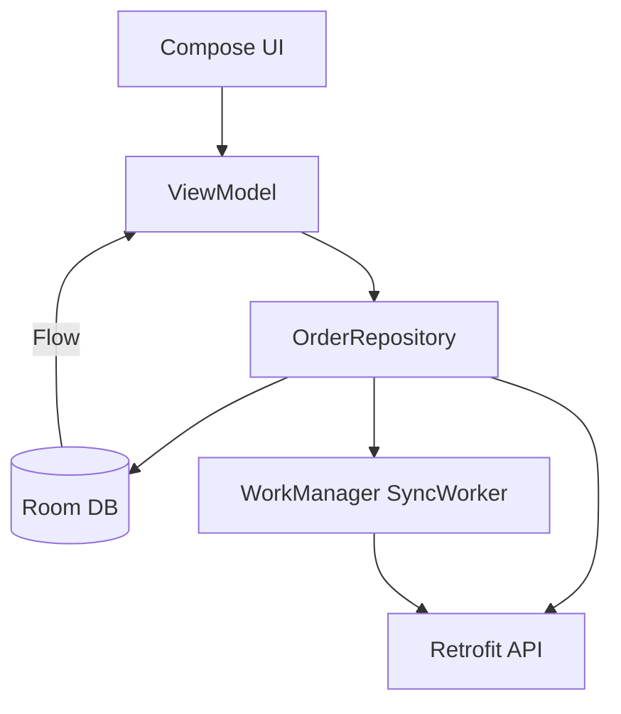

# Android Order Tracker

Offline-first Android app for tracking delivery orders with Kotlin, Jetpack Compose, Room, and Retrofit. Status updates are written to the local database immediately and synced to the server in the background, so the app works without a network connection.

## Measured Results

| Metric | Value |
|---|---|
| Offline-first writes | Instant (Room first, API async) |
| Sync retry strategy | WorkManager with exponential backoff |
| Status transitions | 5-step lifecycle (Placed, Confirmed, Preparing, Out for Delivery, Delivered) |
| Tests | 13 unit tests (domain + repository) |
| Test coverage | Status transitions, offline sync, partial failure recovery |

## Architecture



## Design Decisions

### 1. Offline-first write path

`updateStatus()` writes to Room immediately, then attempts the API call. If the API fails, the order is flagged `pendingSync = true` and the change is visible to the user right away. A `SyncWorker` picks up pending changes when connectivity returns.

### 2. Room as single source of truth

The UI observes `Flow<List<Order>>` from Room, never from the API directly. `refresh()` fetches from the API and upserts into Room. This means the order list and detail screen always render from local state, with no loading spinners for cached data.

### 3. Explicit status state machine

`OrderStatus.next()` returns the only valid next state, or null for terminal states (Delivered, Cancelled). The UI uses this to show or hide the "Advance" button. There is no way to skip a state or go backwards through the normal flow.

### 4. WorkManager for background sync

`SyncWorker` runs as a periodic `CoroutineWorker` with constraints on network availability. It iterates over `pendingSync = true` rows, syncs each one, and marks it synced. Partial failures leave the remaining rows for the next run. WorkManager handles retry with backoff.

### 5. Fake-based testing over mocks

Tests use hand-written `FakeOrderDao` and `FakeOrderApi` implementations rather than mocking libraries. Fakes implement the actual interface and maintain in-memory state, so tests verify behavior (offline writes persist, partial sync retries) rather than interaction patterns.

## Project Structure

```
app/src/main/java/com/siddhant/ordertracker/
  domain/model/     Order, OrderItem, OrderStatus, StatusUpdate
  data/
    local/           Room entities, DAO, database
    remote/          Retrofit API interface, DTOs
    repository/      OrderRepository (offline-first)
    sync/            WorkManager SyncWorker
  ui/
    orders/          Order list screen + ViewModel (Compose)
    detail/          Order detail screen + ViewModel (Compose)

app/src/test/
  domain/            OrderStatus transition tests
  data/              Repository tests with fakes
```

## Quick Start

```bash
# Open in Android Studio
# Build > Make Project

# Run unit tests
./gradlew testDebugUnitTest

# Run on emulator
./gradlew installDebug
```

## Tests

```
domain/OrderStatusTest       5 tests  transitions, terminal states, full lifecycle
data/OrderRepositoryTest     8 tests  refresh, offline updates, pending sync,
                                      partial failure, observe flow, sync count
```

## License

MIT
